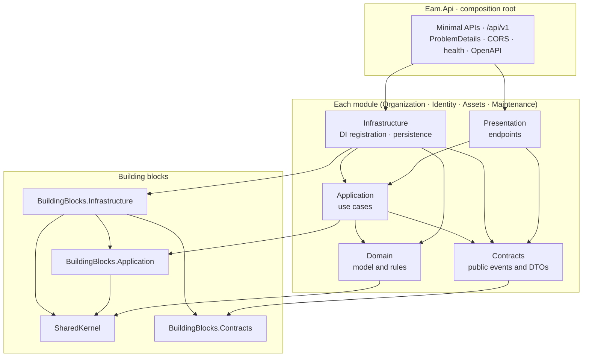

<div align="center">

# Enterprise Asset Management API

**Backend for an enterprise asset and maintenance management platform**: register physical assets, organize them across sites and departments, and plan the maintenance that keeps them running.

[](https://dotnet.microsoft.com)
[](https://learn.microsoft.com/aspnet/core)
[](https://learn.microsoft.com/dotnet/csharp)
[](https://www.openapis.org)
[](https://xunit.net)

</div>

---

## Contents

- [What this is](#what-this-is)
- [Highlights](#highlights)
- [Architecture](#architecture)
- [Tech stack](#tech-stack)
- [Quick start](#quick-start)
- [Configuration](#configuration)
- [Project structure](#project-structure)
- [HTTP surface](#http-surface)
- [Engineering notes](#engineering-notes)
- [Known limitations](#known-limitations)

---

## What this is

The server half of an asset and maintenance management platform for organizations that own physical equipment, vehicles and facilities. The React + TypeScript frontend lives in its own repository; this one holds the API alone.

It is a **modular monolith**: one deployable ASP.NET Core application, divided into business modules (Organization, Identity, Assets, Maintenance) whose boundaries are enforced by the compiler rather than by convention. A module can later be extracted into its own service without first untangling it from the others.

The foundation is in place: the API host, module wiring, error handling, OpenAPI, health and CORS. The business modules are deliberately still empty. This README describes what exists today and labels everything else as not yet built.

## Highlights

| | |
| --- | --- |
| 🧱 **Boundaries the compiler enforces** | Each module is five projects with one-way references. A module cannot reference another module's internals because the project reference does not exist, so the build fails before any review would. |
| 🌐 **Web stays at the edge** | Only `Presentation` projects and the host reference ASP.NET Core. `Infrastructure` depends on `Microsoft.Extensions` abstractions, so HTTP types cannot leak into persistence code. |
| 🧾 **One error format everywhere** | Unhandled exceptions, routing 404s and bad requests all return RFC 9457 `application/problem+json` with a `traceId`. Stack traces never leave the server. |
| 🔒 **Fail-closed configuration** | `AllowedHosts` defaults to loopback only, the CORS allow-list defaults to empty, and origins are validated at startup. A misconfigured deployment refuses to start or rejects traffic; it does not silently accept everything. |
| 🧪 **Tests without infrastructure** | The API runs in memory under `WebApplicationFactory`. Health, OpenAPI, ProblemDetails, CORS and host filtering are checked without Docker or a database. |
| 📦 **Pinned, minimal dependencies** | The SDK is pinned in `global.json`, every package version is set once in `Directory.Packages.props`, and restore audits transitive packages for known vulnerabilities. |

## Architecture

The API host is the composition root: the only project that knows every module. Each module is split into five projects whose references point inward.



<details>
<summary><b>Why a modular monolith, and not microservices</b></summary>

<br>

The domain has clear seams (organization structure, identity, the asset register, maintenance work) but they are not yet proven under real load or real team ownership. Splitting into services now would buy network calls, distributed transactions and deployment overhead before any of them are justified.

A modular monolith keeps one process and one deployment while still drawing the seams:

- **Separate projects per module and layer**, so the dependency rules are physical references rather than folder conventions.
- **No cross-module project references.** Modules will talk only through their `Contracts` project, which holds integration events and narrow interfaces, never domain types.
- **One composition root.** `Eam.Api` calls `Add{Module}Module()` and `Map{Module}Endpoints()` for each module and nothing else.

If a module later needs to scale or deploy on its own, its seam already exists.

</details>

<details>
<summary><b>Why Infrastructure does not reference ASP.NET Core</b></summary>

<br>

Registering services only needs `IServiceCollection`. Referencing the whole `Microsoft.AspNetCore.App` framework for that would also expose `HttpContext`, `IResult` and routing to code whose job is persistence and integration.

So module `Infrastructure` projects take a single package, `Microsoft.Extensions.DependencyInjection.Abstractions`, and resolve only the base `Microsoft.NETCore.App` framework. Writing HTTP-aware code there is a compile error, not a code-review comment. It also means the same registrations can later be loaded by a worker process that has no web host.

`Presentation` projects keep the ASP.NET Core framework reference, because mapping endpoints is their job.

</details>

## Tech stack

| Concern | Choice |
| --- | --- |
| Runtime | .NET 10, C# 14, nullable reference types |
| Web | ASP.NET Core 10 Minimal APIs |
| API description | `Microsoft.AspNetCore.OpenApi` (OpenAPI 3.1) |
| API reference UI | Scalar |
| Errors | RFC 9457 ProblemDetails with `IExceptionHandler` |
| Logging | Built-in ASP.NET Core HTTP logging |
| Testing | xUnit v3 on Microsoft.Testing.Platform, `WebApplicationFactory` |
| Build | `.slnx` solution, `Directory.Build.props`, Central Package Management |

## Quick start

### Prerequisites

- **.NET SDK 10.0.404** (pinned in `global.json`; later 10.0.4xx patches are accepted)

### Run the API

```bash
dotnet run --project src/Bootstrapper/Eam.Api --launch-profile http
```

The API is served at <http://localhost:5087>. Open <http://localhost:5087/scalar/v1> for the API reference.

### Build and test

```bash
dotnet build EnterpriseAssetManagement.slnx
```

```bash
dotnet test --solution EnterpriseAssetManagement.slnx
```

> [!NOTE]
> Tests run on Microsoft.Testing.Platform, opted in through the `test.runner` setting in `global.json`. Use `dotnet test --solution …` rather than passing the solution path positionally.

`src/Bootstrapper/Eam.Api/Eam.Api.http` holds ready-made requests for the endpoints below, runnable from Rider, Visual Studio or the VS Code REST Client.

## Configuration

Non-secret settings live in `appsettings.json` and `appsettings.{Environment}.json`. Secrets are never committed: use `dotnet user-secrets` locally and environment variables or a secret store when deployed.

| Setting | Default | Development | Notes |
| --- | --- | --- | --- |
| `AllowedHosts` | `localhost;127.0.0.1;[::1]` | inherited | Requests with any other `Host` header get **400** |
| `Cors:AllowedOrigins` | empty (no cross-origin access) | `http://localhost:5173` | Exact origins of the frontend; validated at startup |

> [!IMPORTANT]
> **Production must set both.** For example, as environment variables:
>
> ```bash
> AllowedHosts=api.example.com
> Cors__AllowedOrigins__0=https://app.example.com
> ```
>
> Separate multiple hosts with `;`. Never use `*` for either. Origins must be absolute `http`/`https` origins with no path, wildcard or trailing slash, or the API refuses to start.

## Project structure

```
src/
├── Bootstrapper/
│   └── Eam.Api/                  Host and composition root
│       ├── Configuration/        Route constants, CORS settings and policy
│       ├── Extensions/           Service registration and middleware pipeline
│       ├── Middleware/           Global exception handler
│       └── Program.cs
├── BuildingBlocks/
│   ├── Eam.SharedKernel/                 Base types shared by every domain
│   ├── Eam.BuildingBlocks.Application/   Cross-cutting application abstractions
│   ├── Eam.BuildingBlocks.Contracts/     Base types for integration events
│   └── Eam.BuildingBlocks.Infrastructure/
└── Modules/
    ├── Organization/   Domain · Application · Infrastructure · Presentation · Contracts
    ├── Identity/       (same five projects)
    ├── Assets/         (same five projects)
    └── Maintenance/    (same five projects)
tests/
└── IntegrationTests/
    └── Eam.IntegrationTests/     In-memory API host tests
```

<details>
<summary><b>Reference rules per module</b></summary>

<br>

| Project | May reference |
| --- | --- |
| `Domain` | `SharedKernel` |
| `Contracts` | `BuildingBlocks.Contracts` |
| `Application` | own `Domain`, own `Contracts`, `BuildingBlocks.Application` |
| `Infrastructure` | own `Domain`, `Application`, `Contracts`, `BuildingBlocks.Infrastructure` |
| `Presentation` | own `Application`, own `Contracts` |
| `Eam.Api` | each module's `Infrastructure` and `Presentation` only |

</details>

## HTTP surface

| Endpoint | Available in | Purpose |
| --- | --- | --- |
| `GET /health/live` | all environments | Liveness probe; returns `Healthy` while the process serves requests |
| `GET /openapi/v1.json` | Development | OpenAPI 3.1 document |
| `GET /scalar/v1` | Development | Interactive API reference |
| `/api/v1/organization` | all environments | Organization module route group (no endpoints yet) |
| `/api/v1/identity` | all environments | Identity module route group (no endpoints yet) |
| `/api/v1/assets` | all environments | Assets module route group (no endpoints yet) |
| `/api/v1/maintenance` | all environments | Maintenance module route group (no endpoints yet) |

Every error response, including a 404 for an unknown route, is `application/problem+json`:

```json
{
  "type": "https://tools.ietf.org/html/rfc9110#section-15.5.5",
  "title": "Not Found",
  "status": 404,
  "instance": "GET /api/v1/does-not-exist",
  "traceId": "00-c2ae812fd85c4986bd2cd43956d9ea2b-8c0de25d1f2acd38-00"
}
```

## Engineering notes

<details>
<summary><b>Error handling</b></summary>

<br>

- **One handler, one shape.** `GlobalExceptionHandler` implements `IExceptionHandler` and writes through `IProblemDetailsService`, and `UseStatusCodePages` gives empty 4xx/5xx responses the same body. The frontend parses one error format.
- **Nothing internal in production.** Responses carry a status, a title and a `traceId`. In Development the exception message and type are added to speed up debugging; the stack trace is never sent in any environment.
- **A client that hangs up is not a server fault.** When the request is aborted the handler records `499` and writes nothing, instead of logging a 500 for a response no one will read.
- **The `traceId` is the W3C trace id** from `Activity`, so it will line up with distributed traces once OpenTelemetry is added. No custom correlation middleware is needed.

</details>

<details>
<summary><b>Logging</b></summary>

<br>

- **Built-in HTTP logging, deliberately narrow.** Method, path, status code and duration only. Headers, query strings and bodies are excluded so bearer tokens and personal data never reach the log.
- **It sits outermost in the pipeline**, so the status it records is the final one, including errors converted to ProblemDetails.
- **Log messages are source-generated** with `[LoggerMessage]`, so there is no boxing or template parsing on the hot path.

</details>

<details>
<summary><b>CORS and host filtering</b></summary>

<br>

- **The CORS policy is built from validated options**, not from strings scattered through the code. An `IConfigureOptions<CorsOptions>` reads `Cors:AllowedOrigins` after it has passed startup validation.
- **Methods are an explicit list** (`GET`, `POST`, `PUT`, `PATCH`, `DELETE`) and preflight results are cached for ten minutes.
- **Credentials are not allowed yet.** Whether the frontend will use cookies or bearer tokens is still open, and enabling credentials is a decision to make together with that, not ahead of it.
- **Host filtering fails closed.** An unconfigured deployment answers 400 to its real hostname rather than accepting any `Host` header.

</details>

<details>
<summary><b>Build hygiene</b></summary>

<br>

- **Project files carry only what is specific to them.** Target framework, nullable, implicit usings, analyzers and NuGet audit come from `Directory.Build.props`.
- **Nullable warnings are errors.** Other analyzer warnings are reported, and the build currently has none.
- **Package sources are locked to nuget.org** with package source mapping, which closes off dependency-confusion attacks from other configured feeds.
- **Line endings are normalized to LF** through `.gitattributes`, with CRLF kept only for Windows scripts.

</details>

## Known limitations

- **No business functionality yet.** The four modules are registered and have route groups, but contain no endpoints, domain model or use cases.
- **No persistence.** There is no database, `DbContext` or migration; SQL Server with Entity Framework Core is the intended store.
- **No authentication or authorization.** Every route is anonymous, which is acceptable only because no route exposes data.
- **No caching, messaging or background processing.** Redis, RabbitMQ with a transactional outbox, and scheduled jobs are planned but absent.
- **Liveness only.** There is no readiness check, because there are no dependencies to check.
- **No containerization.** There is no Dockerfile or Compose setup. When one is added, `AllowedHosts` and forwarded headers must be configured for the proxy and probe hostnames.
- **Architecture rules are enforced by project references only.** References are transitive, so the host can still *see* Domain types through Infrastructure. Architecture tests to close that gap are not written yet.

---

<div align="center">

Built with .NET 10 · Frontend maintained in a separate React + TypeScript repository

</div>
